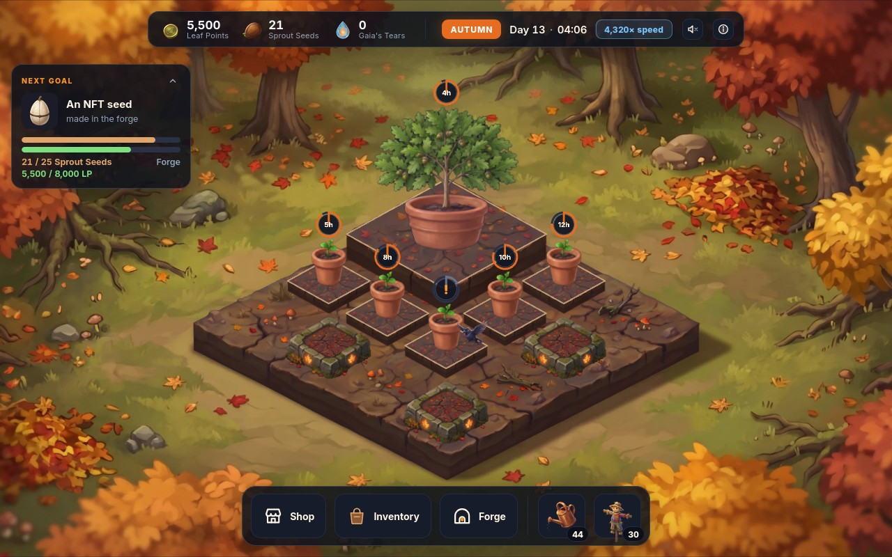
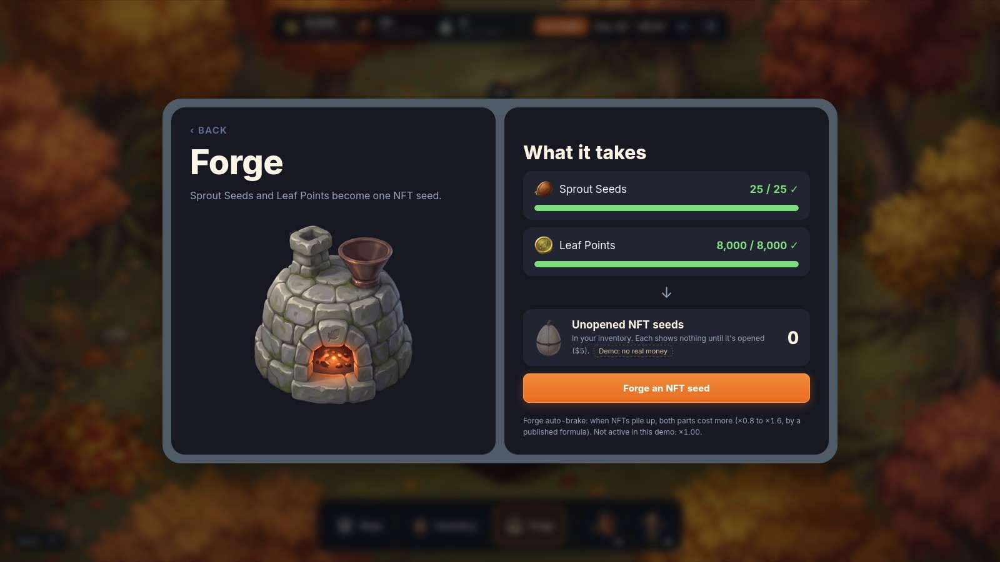
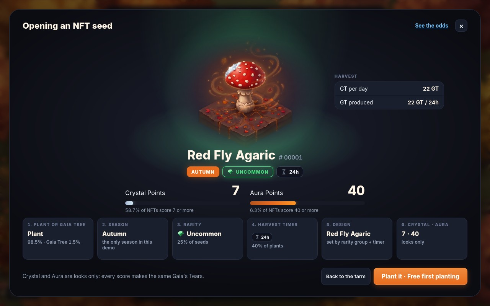
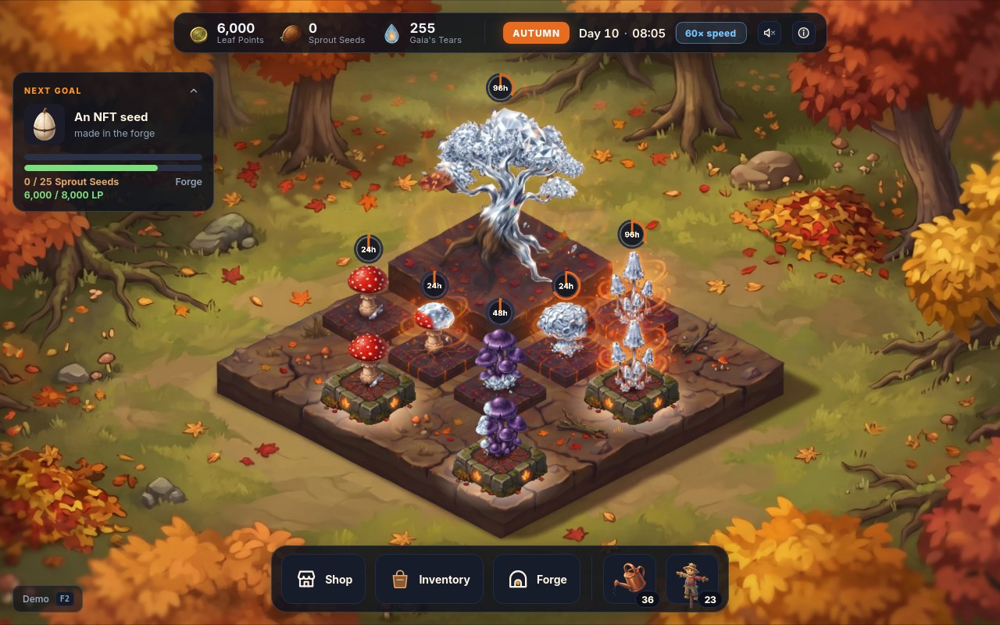

# Lumenglade (working title)

A hand-painted farming game for adults (18+). Players grow magical seasonal plants, forge and open NFT seeds, and trade the rare plants with each other for USDC. There is no game token, and Arbitrum One is our first chain. A playable Autumn demo is done; it has no blockchain and no real money.

**A private link to the demo is sent to reviewers on request:** contact@lumenglade.com.

**Money and paid chance, plainly:** in the full game, players trade plants with each other for USDC (the seller pays 5%), and opening a seed ($5), a land box or Gaia's Altar gives a random result. The odds show before every use; players must be 18+ and ID-checked; it isn't offered where the law forbids it; card payments go through payment partners, never through us; and nothing with real money starts before an independent audit and a lawyer's review.

**The code is private and shared with reviewers on request:** contact@lumenglade.com.

Not an offer to sell anything.
